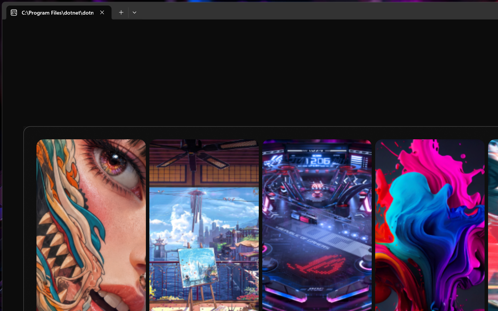

<h1 align="center">WallFlow</h1>


> Entorno de escritorio minimalista y gestor de fondos de pantalla para Windows con Dock elegante, integración de IA (ChatGPT & Gemini), reproductor de música y widgets dinámicos.

<p align="center">
  
</p>

---

## ✨ Novedades y Características

| | |
|---|---|
| 🤖 **Asistente de IA Integrado** | Acceso rápido a **ChatGPT** y **Gemini** en una ventana flotante de cristal acrílico con selector en pestañas Pill y sesión permanente |
| 🎨 **Íconos Vectoriales Lucide** | Sistema completo de íconos vectoriales nítidos **Lucide** en todo el Dock |
| 🖼️ **Galería Local Ultra-Fluida** | Transiciones de papel tapiz sin parpadeos (*Zero Flicker*) y carga ultrarrápida con caché en disco |
| 🎵 **YouTube Music & Reproducción** | Mini reproductor de música flotante con visualizador de ondas y control de pistas |
| 🌐 **Galería Online** | Navega y descarga wallpapers en 4K/2K/HD directamente desde [uhdpaper.com](https://www.uhdpaper.com/) |
| 🎛️ **Dock Estilo macOS / Windows 11** | Accesos directos a apps fijadas, ventanas abiertas, calendario, clima, volumen y energía |
| ⌨️ **Atajos de Teclado & Teclas Rápidas** | `Alt + W` para mostrar u ocultar la galería |

---

## 🚗 Instalación

### 📦 Instalador Ejecutable (Recomendado)
Descarga la versión más reciente del instalador listo para usar:

| Archivo | Descripción |
|---------|-------------|
| 🚀 [`WallFlow-Setup.exe`](installer/WallFlow-Setup.exe) | Instalador completo de Windows con Inno Setup |

### 🛠️ Compilación Automática (Código + Instalador)
Para construir el código fuente y generar el instalador en un solo paso:

```powershell
.\build.ps1
```

---

## ⚙️ Configuración de Directorio

Por defecto WallFlow busca fondos locales en:
```
C:\Users\%USERNAME%\OneDrive\Imágenes\Wallpapers
```

Para usar un directorio personalizado, puedes seleccionarlo en **Ajustes** de la app o crear un archivo `wallflow.txt` junto al ejecutable con la ruta deseada.

---

## 📄 Licencia

Este proyecto está bajo la Licencia [GNU General Public License v3.0](LICENSE).
